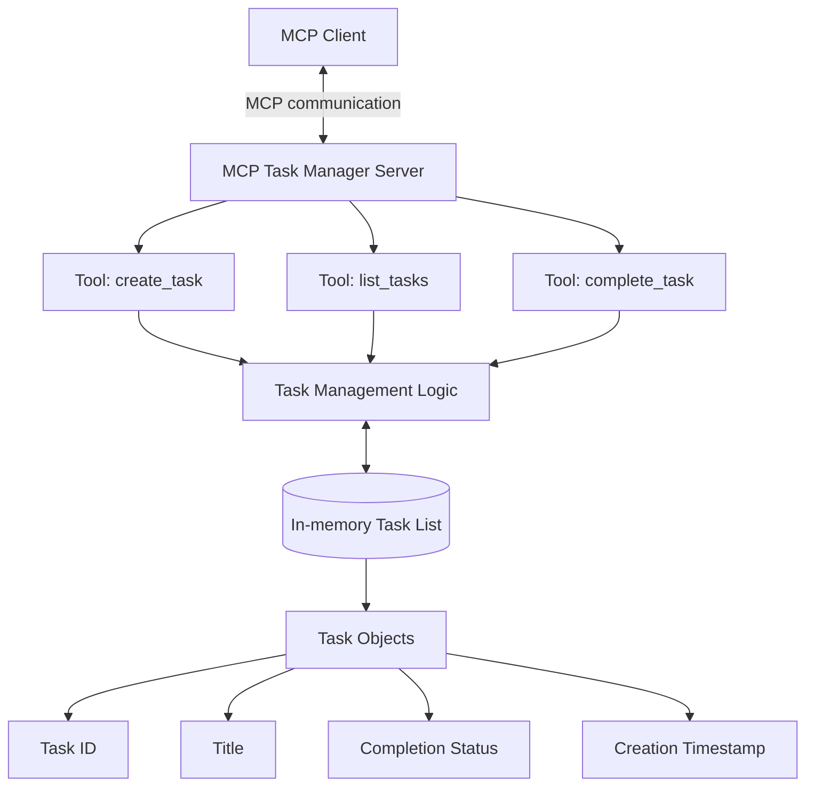

# System Architecture

## 1. Overview

The MCP Task Manager Server is a Python application that exposes task-management functionality through the Model Context Protocol (MCP).

It allows an MCP-compatible client to interact with three tools:

- `create_task`: Creates a new task.
- `list_tasks`: Retrieves all stored tasks.
- `complete_task`: Marks an existing task as completed.

The application uses an in-memory Python list to store task data. It does not currently use a database or persistent storage.

## 2. Architecture Diagram

The diagram below illustrates the relationship between an MCP client, the MCP server, its registered tools, and the in-memory task storage.



## 3. Main Components

### 3.1 MCP Client

The MCP client is the application that connects to the server and invokes its registered tools.

For this project, the MCP development environment and Inspector were used to launch and interact with the server during testing.

The client can request task creation, retrieve tasks, and mark tasks as completed.

### 3.2 MCP Server

The server is implemented in `server.py` using the Python MCP SDK.

It is initialized with:

```python
mcp = MCPServer("Task Manager")
```

The server registers the available tools using the `@mcp.tool()` decorator.

These registered functions provide the task-management operations exposed to the MCP client.

### 3.3 Task Management Logic

The task-management logic is implemented through three Python functions.

| Function | Responsibility |
|---|---|
| `create_task()` | Validates a title, generates an ID and timestamp, and stores a new task. |
| `list_tasks()` | Returns all currently stored tasks. |
| `complete_task()` | Finds a task by ID and updates its completion status. |

Each function operates on the shared in-memory task list.

### 3.4 Task Data Model

Tasks are represented using a Python dataclass:

```python
@dataclass
class Task:
    id: int
    title: str
    completed: bool
    created_at: str
```

Each task contains four fields:

| Field | Data type | Description |
|---|---|---|
| `id` | Integer | Unique task identifier within the current server process. |
| `title` | String | Description of the task. |
| `completed` | Boolean | Indicates whether the task has been completed. |
| `created_at` | String | UTC timestamp recording when the task was created. |

### 3.5 In-Memory Storage

The application stores tasks in a Python list:

```python
tasks: list[Task] = []
```

A counter generates sequential task IDs:

```python
task_id_counter = count(1)
```

When a task is created, it is appended to the list. Other tools access the same list to retrieve or update task information.

Because this storage exists only in memory, task records are lost when the server process stops.

## 4. Task Creation Data Flow

When a client invokes `create_task`, the following operations take place:

1. The client sends a tool request containing a task title.
2. The MCP server routes the request to `create_task()`.
3. The function checks whether the supplied title contains non-whitespace characters.
4. A new task ID is generated.
5. A UTC timestamp is created.
6. A new Task object is instantiated with `completed` set to `False`.
7. The task is appended to the in-memory list.
8. The function returns a success message and the task details.

## 5. Task Completion Data Flow

When a client invokes `complete_task`:

1. The client supplies a task ID.
2. The server routes the request to `complete_task()`.
3. The function searches the in-memory list for the matching ID.
4. If the task exists and is incomplete, its completion status changes to `True`.
5. If it is already completed, the function returns an appropriate message without changing its state.
6. If no matching task exists, the function raises a `ValueError`.

## 6. Technology Stack

| Component | Technology |
|---|---|
| Programming language | Python |
| MCP implementation | Python MCP SDK |
| Data model | Python dataclass |
| Storage | In-memory Python list |
| Task identifiers | Python `itertools.count` |
| Testing | pytest |
| Development and inspection | MCP development environment and Inspector |

## 7. Current Architectural Limitations

The current architecture is intentionally lightweight, but it has some limitations:

- **No persistent storage:** Task records disappear when the server process stops.
- **Single-process state:** Task data is held in the server process's memory.
- **No user separation:** Tasks are not associated with individual users.
- **Limited operations:** Users can create, list, and complete tasks, but cannot edit or delete them.
- **No authentication layer:** The application does not implement its own user authentication.

## 8. Potential Architectural Improvements

Future versions could introduce:

1. SQLite or PostgreSQL for persistent task storage.
2. User-specific task ownership.
3. Tools for editing and deleting tasks.
4. Additional task properties such as priority, due date, and description.
5. More comprehensive validation and error handling.
6. Integration tests covering interactions through an MCP client.

These improvements would expand the application's capabilities while introducing additional architectural considerations.